# Diagrama de casos de uso — Apollo

Sistema de gestão de oficina mecânica (clientes, veículos, estoque, orçamentos e ordens de serviço).

## Atores

| Ator | Descrição |
|------|-----------|
| Funcionário | Usuário da oficina que opera o sistema via interface web |

## Diagrama

```mermaid
flowchart TB
    Funcionario((Funcionário))

    subgraph Apollo["Sistema Apollo"]
        subgraph Clientes["Clientes"]
            UC01[Cadastrar cliente]
            UC02[Listar clientes]
            UC03[Consultar cliente]
            UC04[Excluir cliente]
        end

        subgraph Veiculos["Veículos"]
            UC05[Cadastrar veículo]
            UC06[Listar veículos]
            UC07[Consultar veículo]
            UC08[Atualizar veículo]
            UC09[Excluir veículo]
        end

        subgraph Pecas["Peças e estoque"]
            UC10[Cadastrar peça]
            UC11[Listar / buscar peças]
            UC12[Consultar peça]
            UC13[Atualizar peça]
            UC14[Excluir peça]
            UC15[Registrar movimentação de estoque]
        end

        subgraph Orcamentos["Orçamentos"]
            UC16[Criar orçamento]
            UC17[Listar orçamentos]
            UC18[Consultar orçamento]
            UC19[Atualizar orçamento]
            UC20[Excluir orçamento]
            UC21[Converter orçamento em OS]
        end

        subgraph OS["Ordens de serviço"]
            UC22[Criar ordem de serviço]
            UC23[Listar ordens de serviço]
            UC24[Consultar ordem de serviço]
            UC25[Atualizar ordem de serviço]
            UC26[Excluir ordem de serviço]
        end
    end

    Funcionario --> UC01 & UC02 & UC03 & UC04
    Funcionario --> UC05 & UC06 & UC07 & UC08 & UC09
    Funcionario --> UC10 & UC11 & UC12 & UC13 & UC14 & UC15
    Funcionario --> UC16 & UC17 & UC18 & UC19 & UC20 & UC21
    Funcionario --> UC22 & UC23 & UC24 & UC25 & UC26

    UC21 -.->|inclui| UC22
    UC13 -.->|pode incluir| UC15
```

## Relacionamentos entre casos de uso

| Relação | Tipo | Descrição |
|---------|------|-----------|
| Converter orçamento em OS → Criar ordem de serviço | **include** | A conversão gera uma OS a partir do orçamento aprovado |
| Atualizar peça → Registrar movimentação de estoque | **extend** | Alterações de quantidade registram entrada, saída ou ajuste |

## Casos de uso por módulo

### Clientes
- Cadastrar, listar, consultar e excluir clientes

### Veículos
- Cadastrar veículo vinculado a um cliente
- Listar, consultar, atualizar e excluir veículos

### Peças e estoque
- Gerenciar catálogo de peças (CRUD)
- Controlar estoque com histórico de movimentações (`entrada`, `saída`, `ajuste`)

### Orçamentos
- Criar orçamento com itens (serviço e/ou peça)
- Acompanhar status: `rascunho`, `enviado`, `aprovado`, `rejeitado`, `convertido`
- Converter orçamento aprovado em ordem de serviço

### Ordens de serviço
- Abrir e gerenciar OS (direta ou convertida de orçamento)
- Acompanhar status: `aberta`, `em_andamento`, `aguardando_pecas`, `concluida`, `cancelada`
