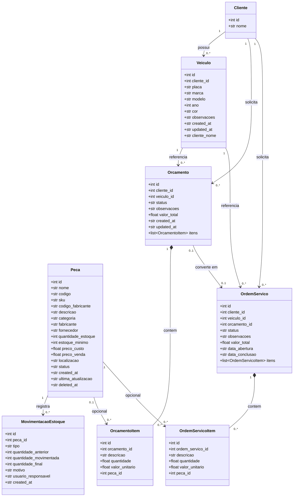

# Diagrama de classes — Apollo

Diagrama UML das classes de domínio (`app/models`).

## Cardinalidades

- Cliente **1:N** Veículo / Orçamento / Ordem de Serviço
- Orçamento **1:N** Itens
- Ordem de Serviço **1:N** Itens
- Orçamento **0..1 ↔ 0..1** Ordem de Serviço
- Peça **1:N** Movimentações de estoque
- Peça **opcional** nos itens de orçamento e OS
