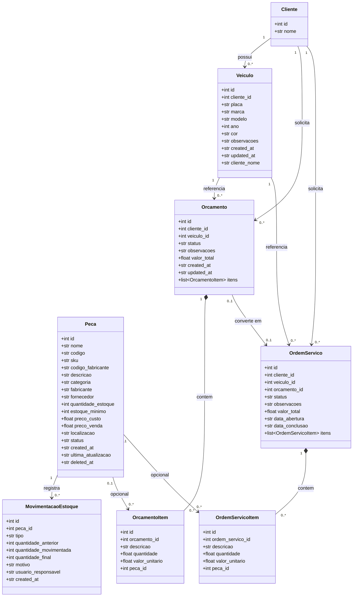
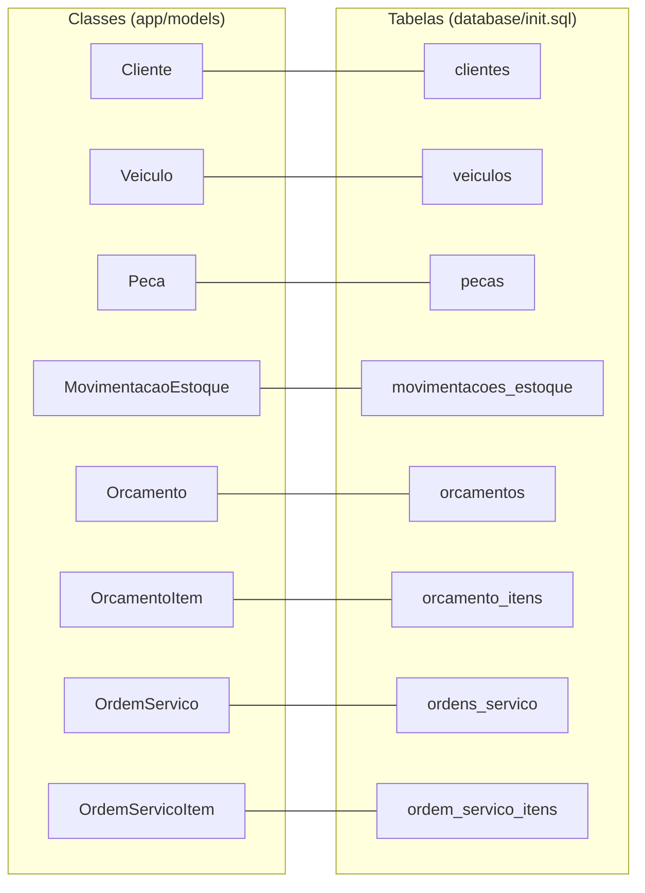

# Diagramas Apollo

Documentação dos diagramas de classes, MER (banco de dados) e da relação entre domínio e tabelas.

## Diagrama de classes



## MER (banco de dados)

```mermaid
erDiagram
    CLIENTES ||--o{ VEICULOS : "possui"
    CLIENTES ||--o{ ORCAMENTOS : "solicita"
    CLIENTES ||--o{ ORDENS_SERVICO : "solicita"
    VEICULOS ||--o{ ORCAMENTOS : "referencia"
    VEICULOS ||--o{ ORDENS_SERVICO : "referencia"
    ORCAMENTOS ||--o{ ORCAMENTO_ITENS : "contem"
    ORCAMENTOS |o--o| ORDENS_SERVICO : "converte_em"
    ORDENS_SERVICO ||--o{ ORDEM_SERVICO_ITENS : "contem"
    PECAS ||--o{ MOVIMENTACOES_ESTOQUE : "registra"
    PECAS |o--o{ ORCAMENTO_ITENS : "pode_vincular"
    PECAS |o--o{ ORDEM_SERVICO_ITENS : "pode_vincular"

    CLIENTES {
        serial id PK
        varchar nome
    }

    VEICULOS {
        serial id PK
        int cliente_id FK
        varchar placa UK
        varchar marca
        varchar modelo
        int ano
        varchar cor
        text observacoes
        timestamptz created_at
        timestamptz updated_at
    }

    PECAS {
        serial id PK
        varchar nome
        varchar codigo UK
        varchar sku UK
        varchar codigo_fabricante
        text descricao
        varchar categoria
        varchar fabricante
        varchar fornecedor
        int quantidade_estoque
        int estoque_minimo
        numeric preco_custo
        numeric preco_venda
        varchar localizacao
        varchar status
        timestamptz created_at
        timestamptz ultima_atualizacao
        timestamptz deleted_at
    }

    MOVIMENTACOES_ESTOQUE {
        serial id PK
        int peca_id FK
        varchar tipo
        int quantidade_anterior
        int quantidade_movimentada
        int quantidade_final
        varchar motivo
        varchar usuario_responsavel
        timestamptz created_at
    }

    ORCAMENTOS {
        serial id PK
        int cliente_id FK
        int veiculo_id FK
        varchar status
        text observacoes
        numeric valor_total
        timestamptz created_at
        timestamptz updated_at
    }

    ORCAMENTO_ITENS {
        serial id PK
        int orcamento_id FK
        varchar descricao
        numeric quantidade
        numeric valor_unitario
        int peca_id FK
    }

    ORDENS_SERVICO {
        serial id PK
        int cliente_id FK
        int veiculo_id FK
        int orcamento_id FK_UK
        varchar status
        text observacoes
        numeric valor_total
        timestamptz data_abertura
        timestamptz data_conclusao
        timestamptz created_at
        timestamptz updated_at
    }

    ORDEM_SERVICO_ITENS {
        serial id PK
        int ordem_servico_id FK
        varchar descricao
        numeric quantidade
        numeric valor_unitario
        int peca_id FK
    }
```

## Relação classe ↔ tabela



## Cardinalidades principais

- Cliente **1:N** Veículo / Orçamento / Ordem de Serviço
- Orçamento **1:N** Itens
- Ordem de Serviço **1:N** Itens
- Orçamento **0..1 ↔ 0..1** Ordem de Serviço (`orcamento_id` UNIQUE)
- Peça **1:N** Movimentações de estoque
- Peça **opcional** nos itens de orçamento e OS
